<p align="center">
  
</p>

<p align="center">
  <a href="https://github.com/manxingxing/dictol/releases"></a>
</p>

<h1 align="center">Dictol</h1>

一款基于 Electron 的桌面词典应用。Dictol 将本地 MDX/MDD 词典、在线词典和可选的 AI 服务放进同一个查词工作区，并提供跨应用划词、文本翻译、生词本等功能。

> Dictol 不随安装包分发本地词典。AI 功能同样是可选的，需要用户自行配置 OpenAI-compatible 服务。

## 功能特性

- **本地词典**：导入 MDX/MDD 词典，支持扫描目录批量导入、自定义样式，单词典和聚合两种视图。
- **在线词典**：配置在线词典并在侧边栏中浏览，支持多标签。
- **AI 查词**：在词条侧栏或划词浮窗中获取 AI 解释。
- **翻译**：通过可配置服务进行文本翻译和截图翻译，支持MacOS系统翻译、火山翻译、百度翻译、google、bing及LLM作为翻译引擎。
- **跨应用取词**：划词工具栏、快捷键取词和悬停查词；支持 AI 解释与朗读。
- **语境查词**：悬停英文单词，结合所在句子由 AI 解释词义和句意，并可保存为摘抄。
- **生词本**：创建多个词本，支持搜索、批量管理、导入和 Excel 导出。
- **摘抄与笔记**：保存词典例句和笔记，支持全文搜索


## 应用截图

<table>
  <tr>
    <td align="center"><strong>主界面查词</strong><br>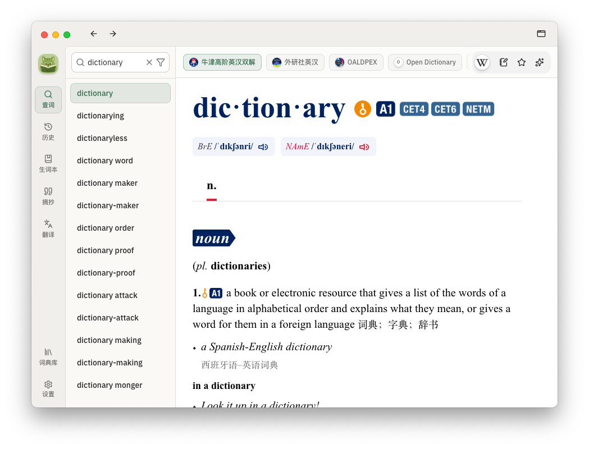</td>
    <td align="center"><strong>多词典聚合视图</strong><br>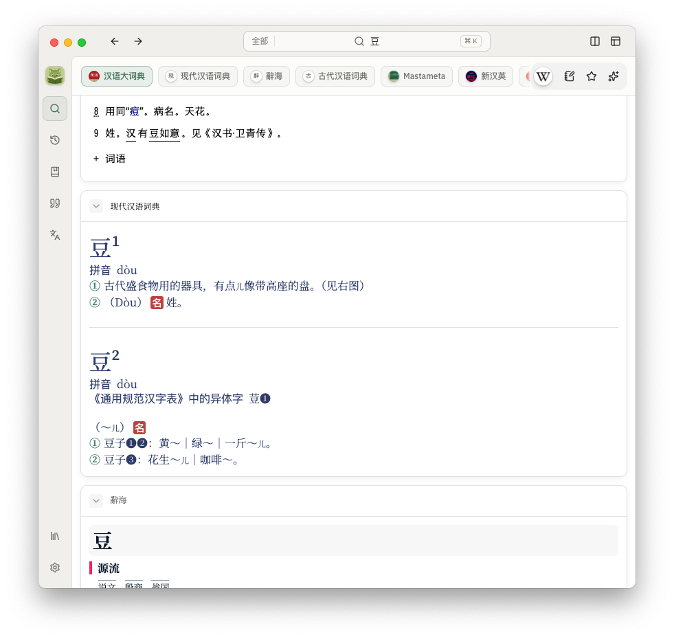</td>
    <td align="center"><strong>在线词典</strong><br>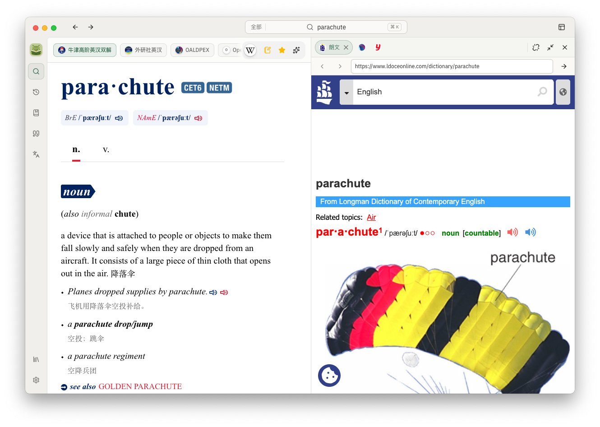</td>
  </tr>
  <tr>
    <td align="center"><strong>词典分组管理</strong><br>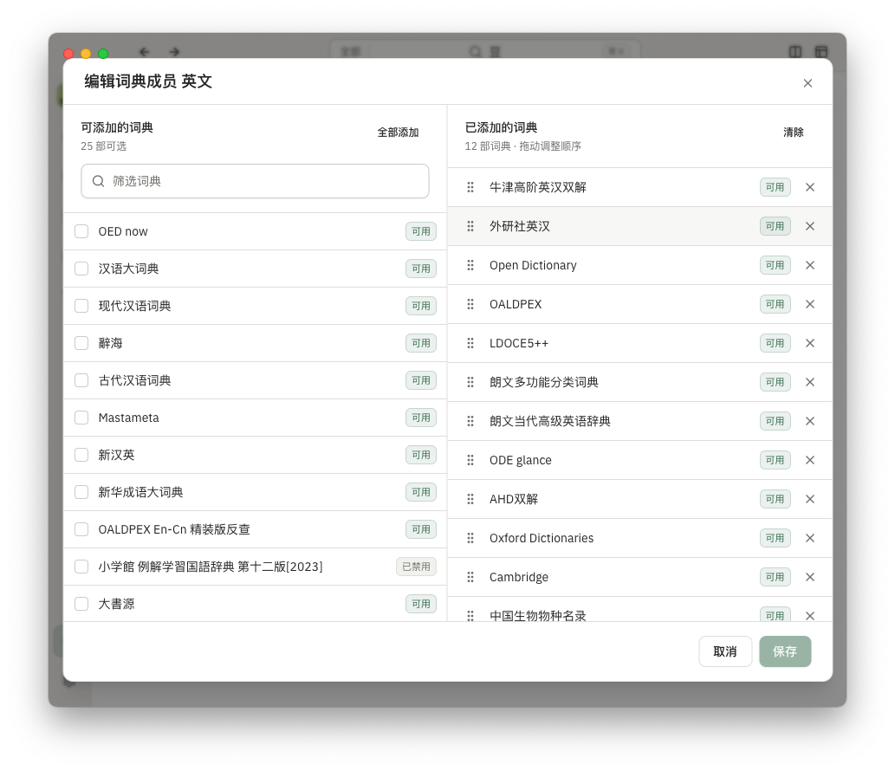</td>
    <td align="center"><strong>扫描导入词典</strong><br></td>
    <td align="center"><strong>AI 查词与对话</strong><br>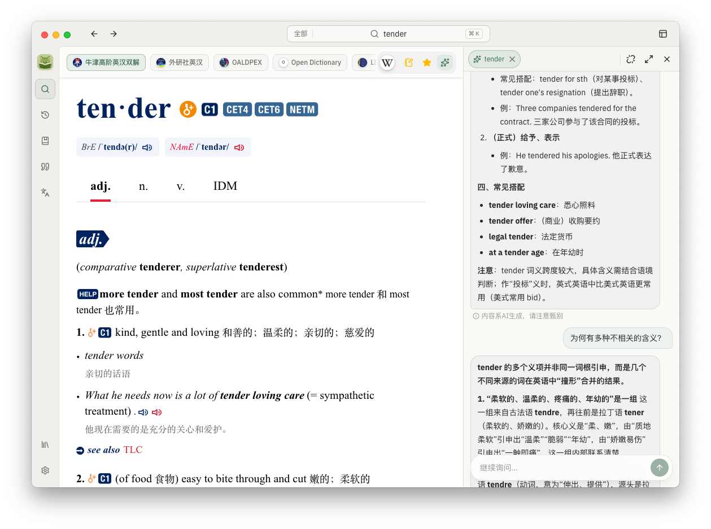</td>
  </tr>
  <tr>
    <td align="center"><strong>AI 解释中文词条</strong><br>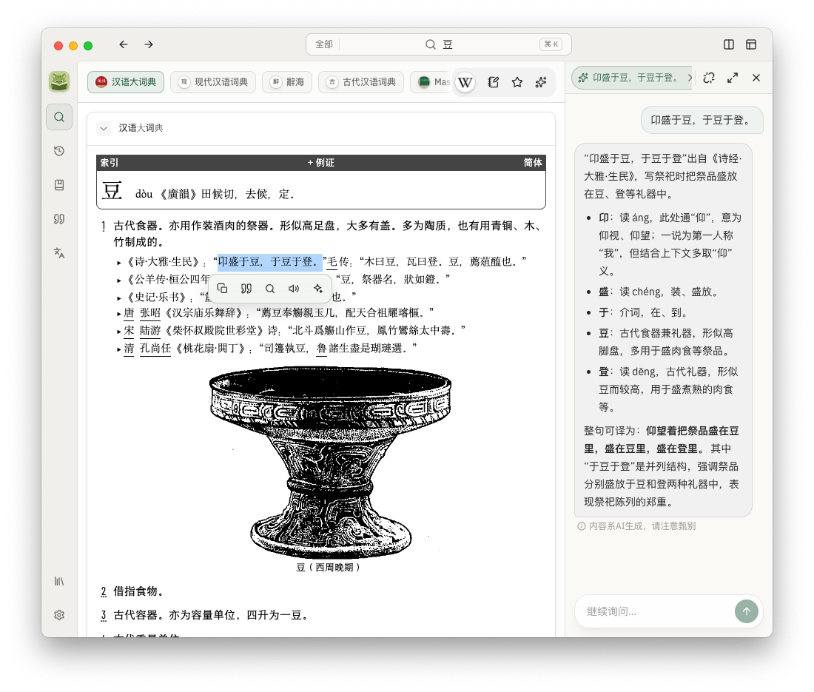</td>
    <td align="center"><strong>语境查词</strong><br>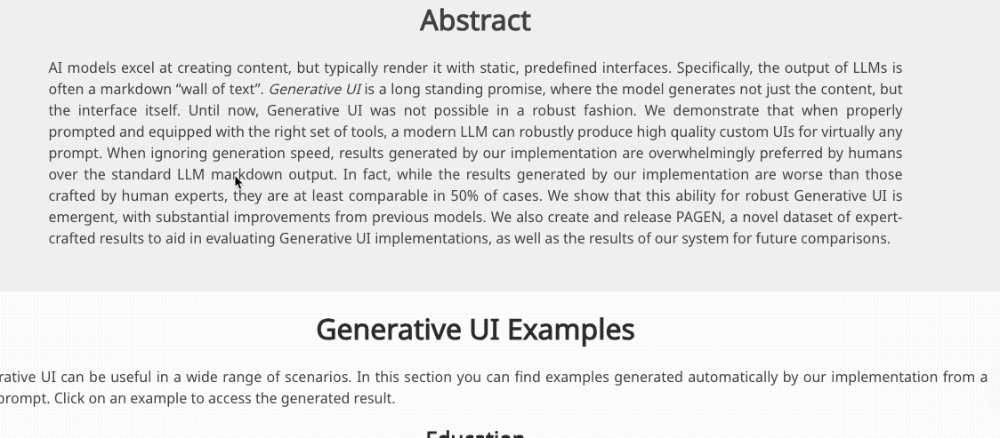</td>
    <td align="center"><strong>文本翻译</strong><br>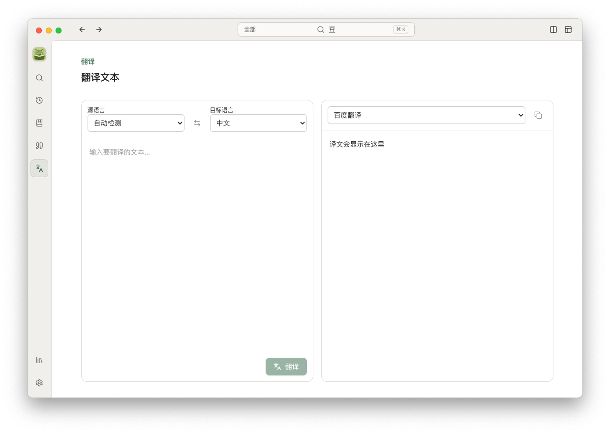</td>
  </tr>
  <tr>
    <td align="center"><strong>划词工具栏</strong><br>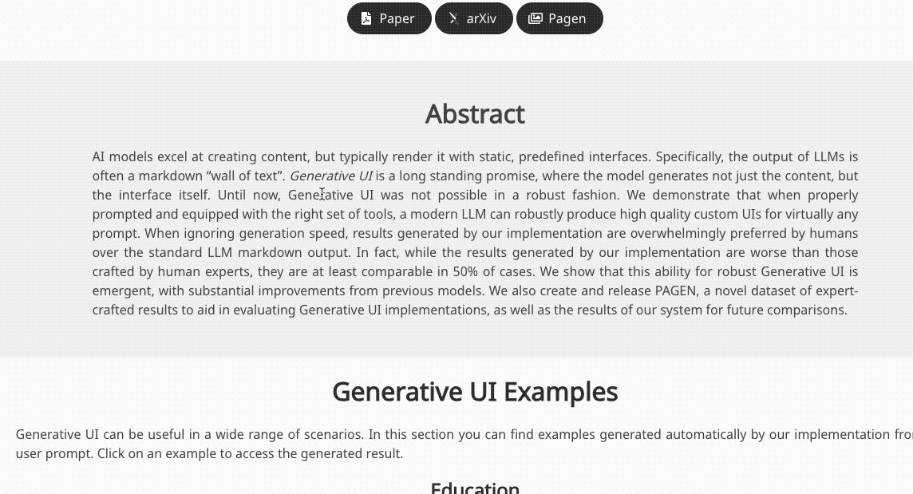</td>
    <td align="center"><strong>划词翻译</strong><br>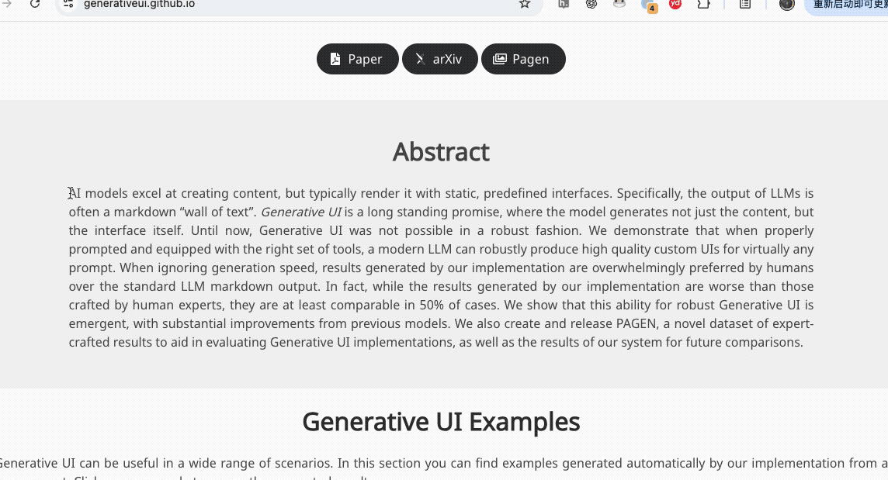</td>
    <td align="center"><strong>摘抄与笔记</strong><br>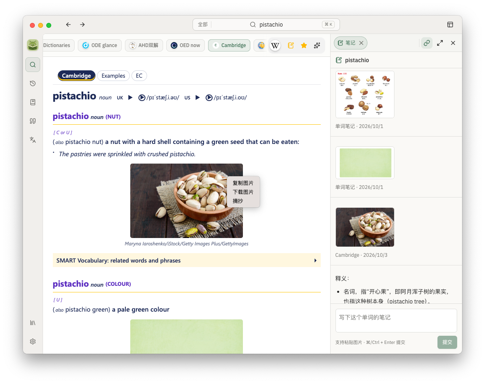</td>
  </tr>
  <tr>
    <td align="center"><strong>自定义词典样式</strong><br>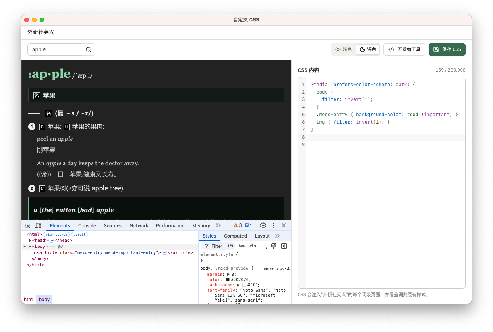</td>
    <td align="center"><strong>配置 AI 服务</strong><br>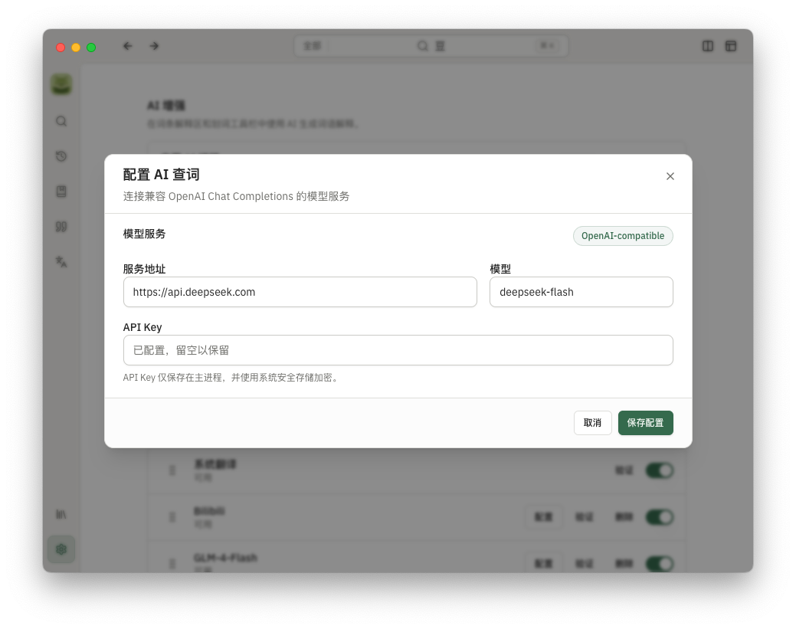</td>
    <td></td>
  </tr>
</table>


## 技术栈

| 层       | 技术                                                                                   |
| -------- | -------------------------------------------------------------------------------------- |
| 桌面框架 | Electron 43 + electron-vite 5                                                          |
| 前端     | React 19、TypeScript、Tailwind CSS 4、shadcn/ui、React Router、TanStack Query、Zustand |
| 词典解析 | Rust `native/mdict`（v1/v2/v3），经 NAPI-RS 封装为 `@dictol/mdict-native`              |
| 本地存储 | SQLite（better-sqlite3）+ Drizzle ORM                                                  |
| 打包     | electron-builder（macOS / Windows / Linux）                                            |

## 开发

```bash
nvm use            # Node 24+
npm install
npm run dev        # 启动开发模式（使用已构建的 .node 文件）
npm run typecheck       # TypeScript 类型检查（node + web）
npm run lint            # ESLint
npm run build           # 原生构建 + 类型检查 + electron-vite 构建
npm run build:mac       # 打包 macOS
npm run build:win       # 打包 Windows
```

## 未来开发计划

- [ ] 整合 TTS 服务商
- [ ] 改善 OCR 识别效果
- [ ] 整合 OCR 服务商
- [ ] 管理 AI 服务商与 Prompt
- [ ] 提供局域网 Web 服务共享
- [ ] 支持 Hunspell
- [ ] 添加生词卡（包含笔记和摘抄例句）
- [ ] 改善搜索候选词性能
- [ ] 适配词典深色模式

## 捐赠

如果 Dictol 对你有帮助，欢迎通过支付宝支持项目。

<table>
  <tr>
    <th align="center">Alipay</th>
  </tr>
  <tr>
    <td align="center"></td>
  </tr>
</table>
