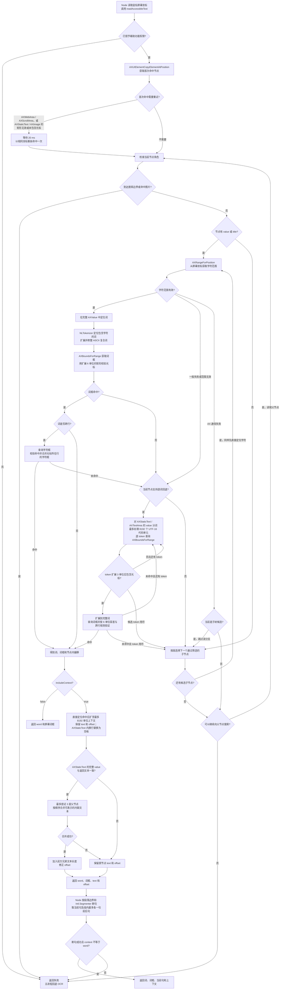
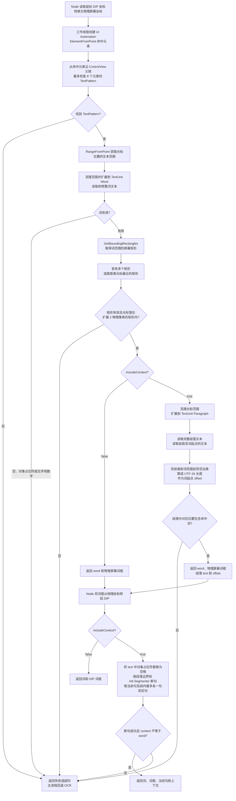

# 悬停取词的 Accessibility 实现

两张图覆盖 `readAccessibleText(x, y, includeContext)` 及 Node 主进程的上下文处理。`includeContext = false` 用于普通查词，`true` 用于 AI 语境查词。`text` 的 `offset` 以 UTF-16 代码单元计数。

## macOS Accessibility

- 搜索子树采用逐层遍历。空文本容器继续展开，有文本的子节点先按节点矩形筛选。通过筛选后，与首次节点、父节点共用“直接字符定位 → 必要时逐词回退”的路径。子节点通信失败时跳过该分支、继续其他候选。超过 100 个直接子节点的分支被跳过，继续搜索其他分支。搜索祖先最多向上 2 层，各子树合计最多遍历 500 个不同子节点；命中节点与向上查找的祖先不计入。`AXWebArea`、`AXScrollArea`、`AXWindow` 和 `AXApplication` 是祖先搜索边界。
- 节点 value 在定位与上下文扩展中复用，token 与词范围相同时复用矩形。直接定位在完整 `AXValue` 上分词；没有 value 或字符偏移越界时直接定位失败。AI 命中后才截取最多 8192 单位上下文。逐词回退保留 8192 单位输入上限。所有命中统一组装结果和扩展上下文，重试不生成中间 JSON。
- 图中逐词回退的 `offset` 是命中 token 的起点。直接字符定位路径的 `offset` 对应命中字符。词首或词尾的字符框不可用时，现有实现会保留已通过初步校验的词框。
- 内联合并最多访问 64 个节点、深度 4，要求子节点可以完整表示并包含目标节点与至少两个静态文本叶子。静态文本节点内部的换行替换为空格，独立 `AXLineBreak` 追加换行。
- 实现见 [macOS 原生查词](/Users/alan/projects/Dictol/native/accessibility/macos/src/accessibility.m) 和 [macOS 主进程适配器](/Users/alan/projects/Dictol/src/main/accessibility/platforms/macos.ts)。

## Windows UI Automation

- Windows 主进程对原生查词等待最多 1.2 秒。等待超时后可以进入 OCR，已启动的原生任务仍会继续执行。
- UI Automation 提供的段落范围取决于目标应用。原生 `offset` 指向去除前导空白后的词起点，Node 在这段文本内提取句子。
- 实现见 [Windows UI Automation](/Users/alan/projects/Dictol/native/accessibility/windows/src/ui_automation.rs) 和 [Windows 主进程适配器](/Users/alan/projects/Dictol/src/main/accessibility/platforms/windows.ts)。

两平台的断句和回退判断共用 [Accessibility 结果处理](/Users/alan/projects/Dictol/src/main/ocr/accessibility.ts) 和 [sentenceContextAt](/Users/alan/projects/Dictol/src/main/ocr/ocr-text.ts)。
