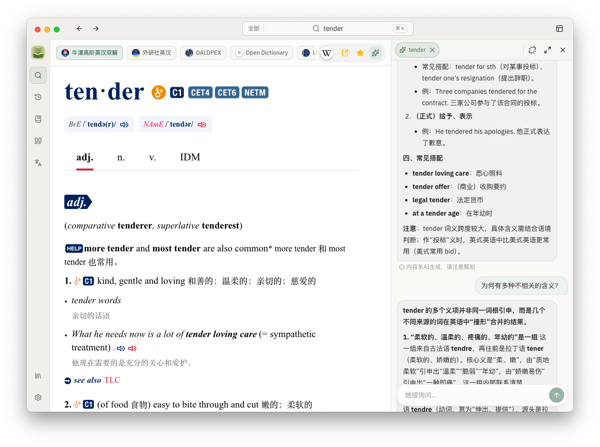
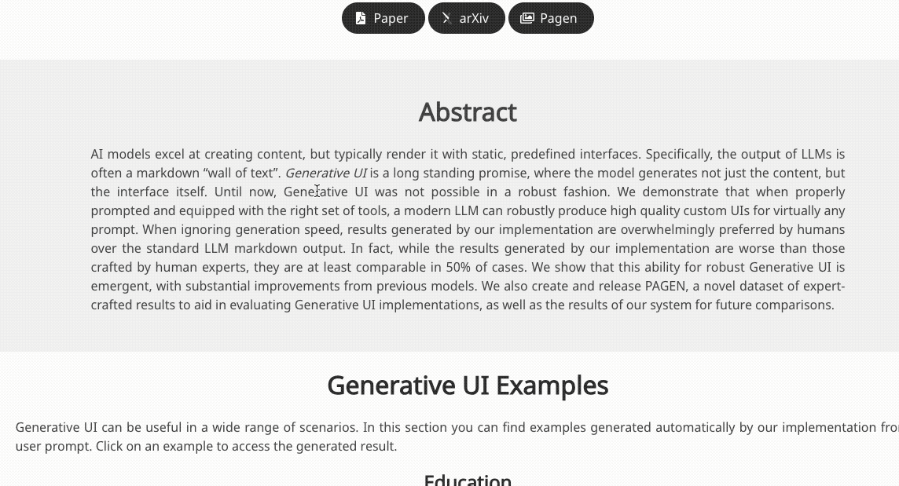
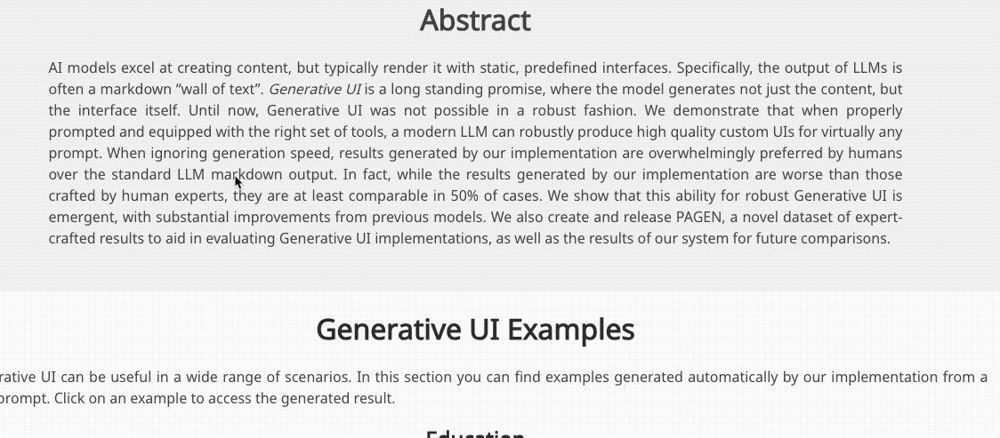
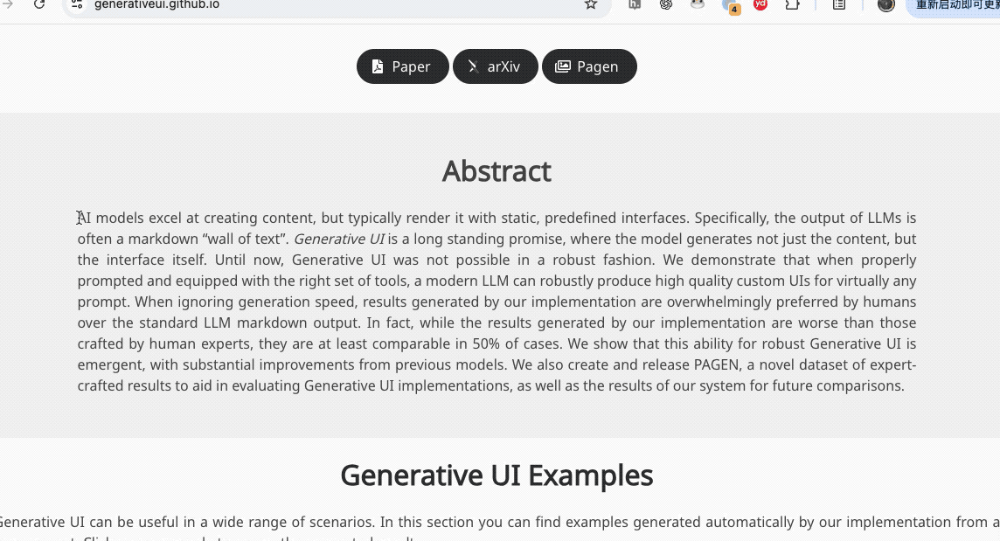

# 【开发者自荐】Dictol: 一个集mdx词典，翻译，AI 于一体的词典软件

大家好，我在做一个桌面词典工具 Dictol，想把本地词典、在线词典、翻译和跨应用查词放进同一个工作区。

做它主要是想少在词典、浏览器、翻译工具和 AI 对话之间来回切换。现在 Dictol 支持：

- **本地 MDX/MDD 词典**：支持扫描文件夹批量导入、多词典分组和聚合查看；词典里的图片、音频和交互内容也可以正常呈现。
- **在线词典**：在查词窗口的侧栏中打开在线词典，可以同时保留多个标签。
- **跨应用取词**：在其他应用中选中文本后，可用浮动工具栏查词、翻译、复制或请求 AI 解释；也支持快捷键取词。
- **语境查词**：悬停英文单词，结合它所在的句子查看 AI 对词义和句意的解释。
- **翻译**：支持文本翻译、选中文本翻译和截图翻译，可配置 macOS 系统翻译、火山、百度、Google、Bing 或兼容 OpenAI 的模型服务。
- **摘抄、笔记和生词本**：把词典例句保存为摘抄，添加笔记并整理到笔记本；单词也可以收藏到生词本，之后搜索、批量管理或导出 Excel。

**跨应用划词**

**语境查词**

**划词翻译**

AI 功能是可选的，需要自行配置兼容 OpenAI 的模型服务和 API Key；Dictol 不附带模型额度。安装包也不包含词典文件，需要自己准备 MDX/MDD 词典。

目前主要面向 macOS 和 Windows。安装包可以从 GitHub Releases 下载，源码和项目说明也放在 GitHub：

- 下载：[GitHub Releases](https://github.com/manxingxing/dictol/releases)
- 项目主页：[github.com/manxingxing/dictol](https://github.com/manxingxing/dictol)

欢迎试用，也欢迎反馈使用中的问题，或者告诉我你希望词典工具优先改进什么。
