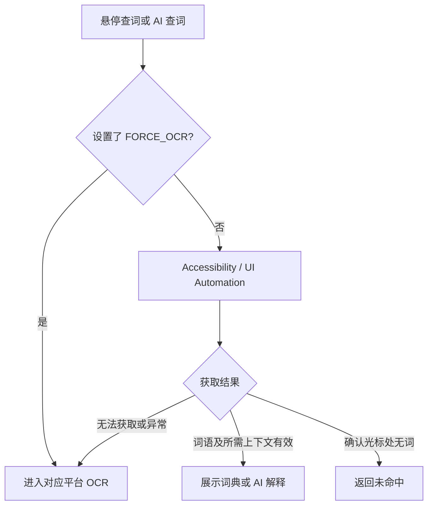
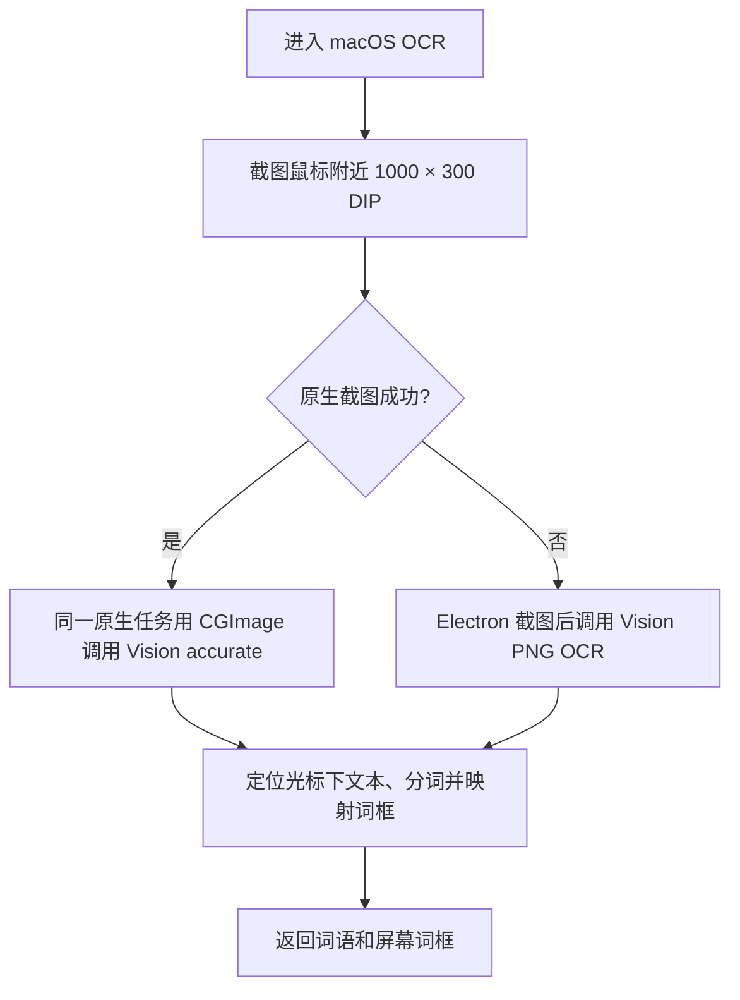
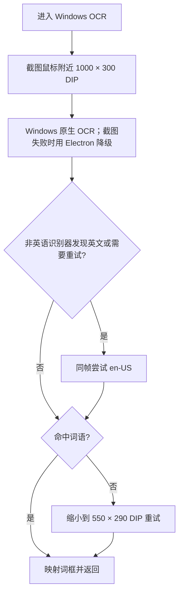
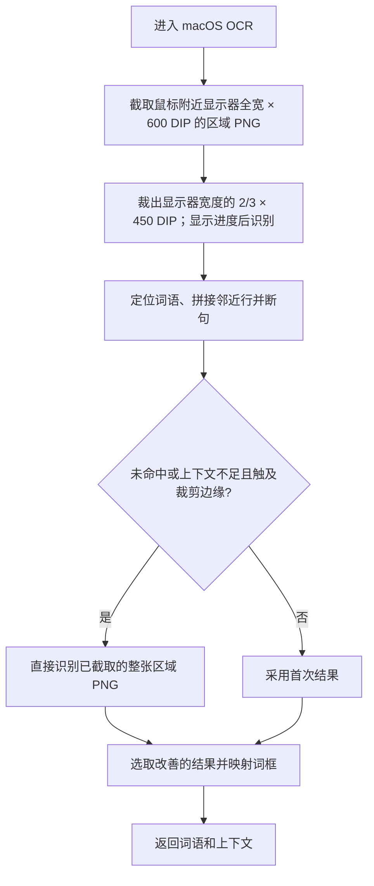
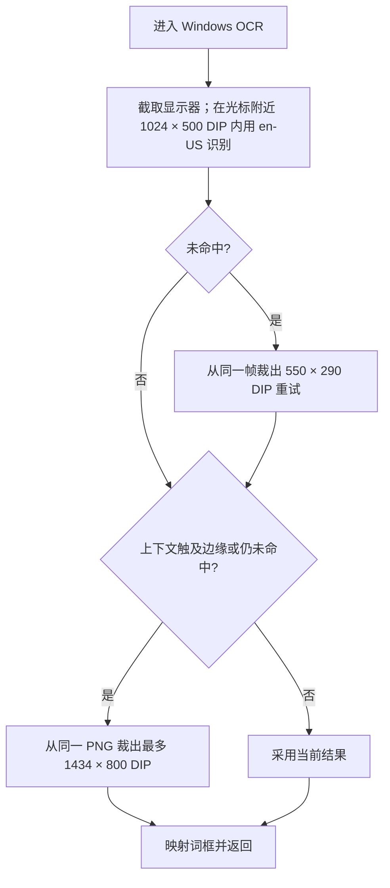
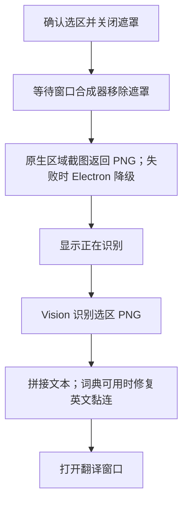
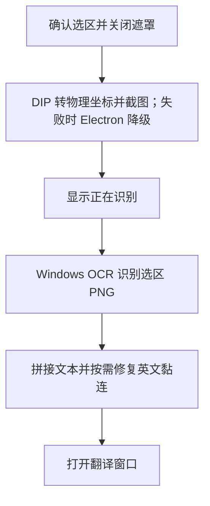

# 悬停查词、AI 语境查词与截图翻译流程

macOS 使用 Apple Vision，Windows 使用 Windows.Media.Ocr。OCR 引擎按平台固定，不提供引擎配置页。

## 悬停入口与 FORCE_OCR

普通查词和 AI 查词共用 `src/main/ocr/ocr.ts`。未设置 `FORCE_OCR` 时先尝试系统辅助功能；已确认光标位于空白时直接返回，无法取得可靠文本或调用失败时才进入 OCR。设置 `FORCE_OCR` 后完全跳过辅助功能。

使用 `FORCE_OCR=1 npm run dev` 或 `FORCE_OCR=1 npm run inspect` 调试。只要环境变量存在即启用，包括空字符串；取消设置后恢复辅助功能优先。该开关不改变截图翻译路径。

## macOS 悬停查词

普通查词使用 `captureAndRecognizeMacText`，正常路径只传递显示器、坐标、语言和识别结果，不传 PNG 或图像句柄。未命中时直接返回。只有截图阶段失败才使用 Electron 降级，OCR 错误直接向上传递。

## Windows 悬停查词

## macOS AI 语境查词

原生截图失败时使用 Electron 截图和 Vision PNG OCR；语言自动检测始终开启。

## Windows AI 语境查词

## macOS 截图翻译

截图先于进度窗口，因此无需过滤提示窗。原生与降级路径均使用捕获好的 PNG，不保留原生图片句柄。

## Windows 截图翻译

## 对照源码

- [悬停入口及 FORCE_OCR](../src/main/ocr/ocr.ts)、[Accessibility 结果处理](../src/main/ocr/accessibility.ts)。
- [macOS OCR](../src/main/ocr/mac-ocr.ts)、[Windows OCR](../src/main/ocr/win-ocr.ts)、[文本命中与上下文](../src/main/ocr/ocr-text.ts)。
- [截图翻译](../src/main/action/screenshot-translation.ts)、[识别与文本拼接](../src/main/ocr/screenshot-ocr.ts)、[截图适配](../src/main/ocr/screen-capture.ts)。
