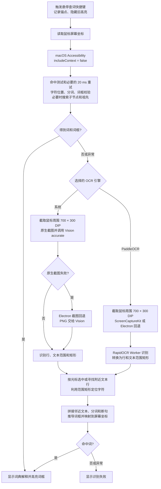
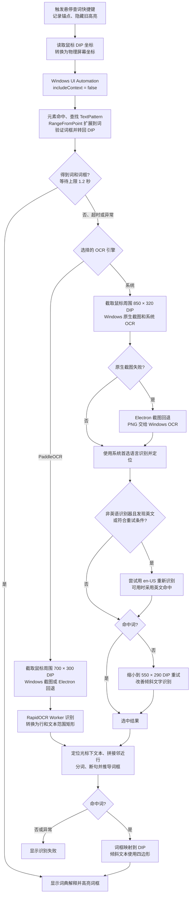
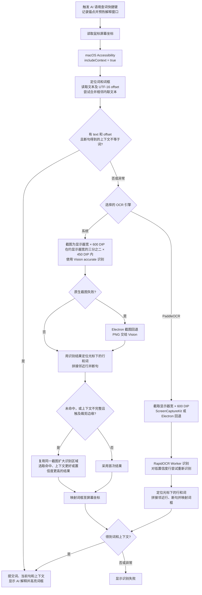
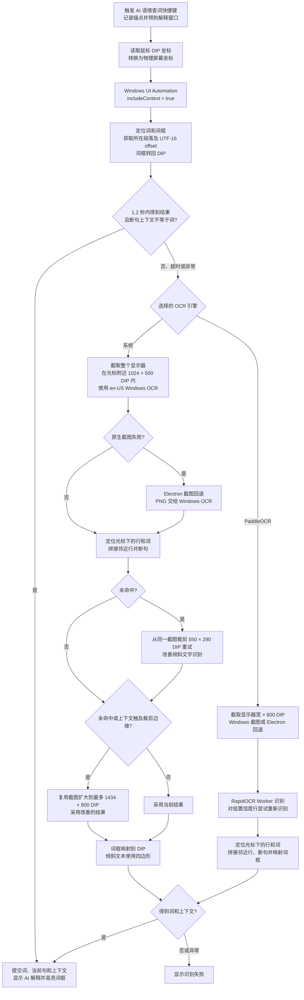
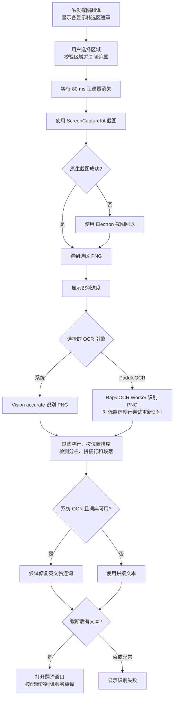
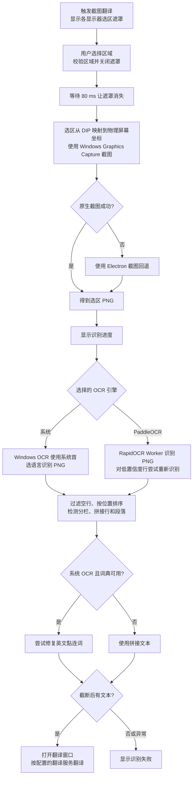

# 悬停查词、AI 语境查词与截图翻译流程

本文依据当前源码绘制。每张图对应一个功能和操作系统，展示已实现的分支。系统 OCR 与 PaddleOCR 都有各自的悬停入口，目前部分后处理仍共用 `selectOcrTextHit()`。

## macOS 悬停查词

## Windows 悬停查词

## macOS AI 语境查词

## Windows AI 语境查词

## macOS 截图翻译

## Windows 截图翻译

## 对照源码

- 入口与 Accessibility 回退：[悬停路由](../src/main/ocr/ocr.ts)、[Accessibility 结果处理](../src/main/ocr/accessibility.ts)、[悬停弹窗](../src/main/controller/selection-toolbar.ts)。
- 悬停 OCR：[macOS 系统 OCR](../src/main/ocr/mac-ocr.ts)、[Windows 系统 OCR](../src/main/ocr/win-ocr.ts)、[PaddleOCR](../src/main/ocr/paddle-ocr.ts)、[共享词定位与上下文处理](../src/main/ocr/ocr-text.ts)。
- 截图翻译：[选区与窗口](../src/main/action/screenshot-translation.ts)、[引擎调用](../src/main/ocr/screenshot-ocr.ts)、[文本组装](../src/main/ocr/ocr-translation.ts)、[截图适配](../src/main/ocr/screen-capture.ts)。

系统 OCR 与 PaddleOCR 的截图、识别、重试策略分别实现，当前悬停取词仍共用部分命中、分词、上下文和词框处理。截图翻译共享行和段落组装，系统 OCR 在词典可用时额外执行英文黏连修复。
