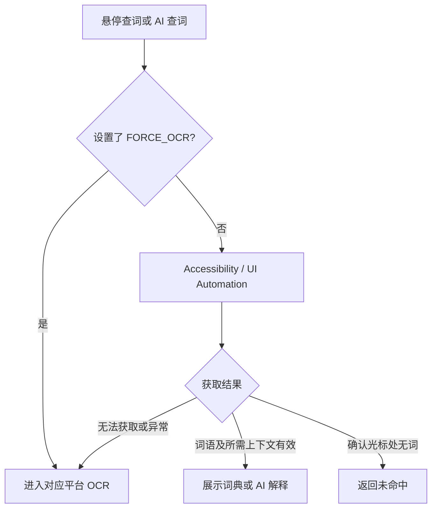
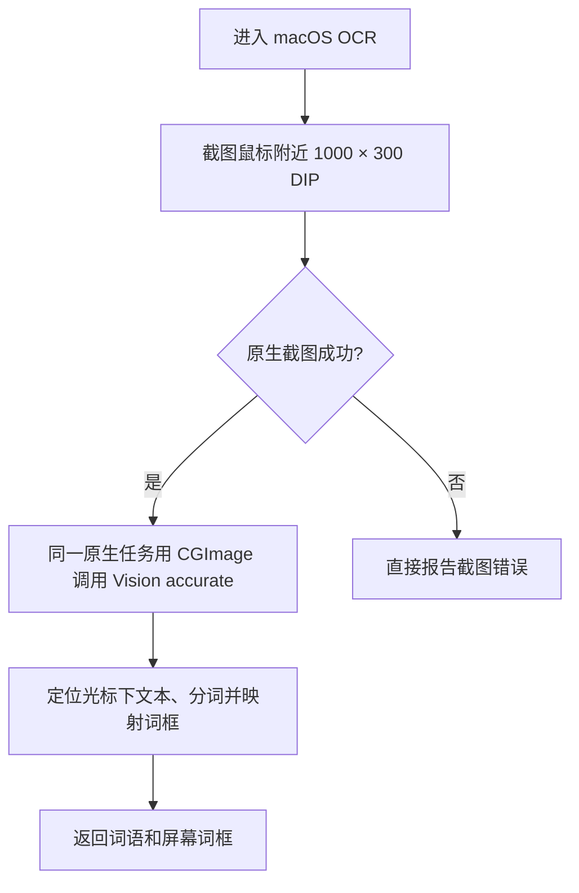
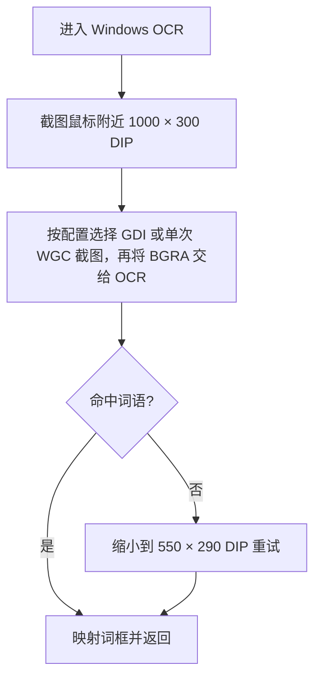
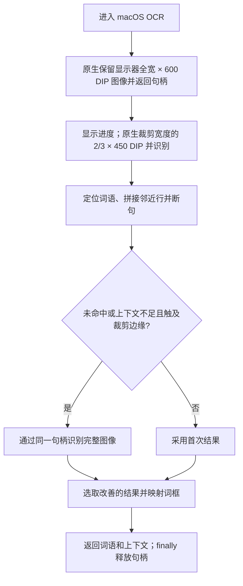
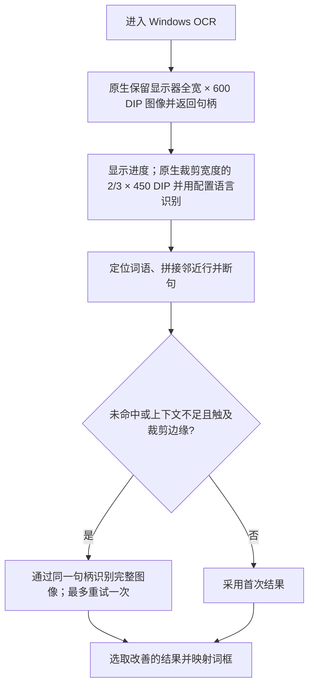
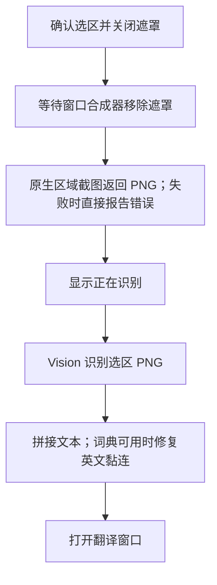
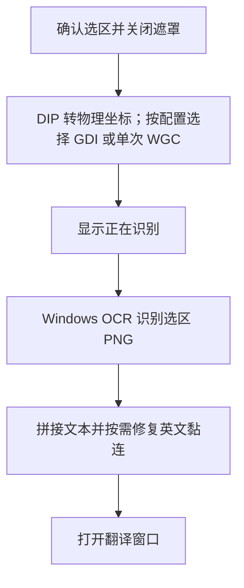

# 悬停查词、AI 语境查词与截图翻译流程

macOS 使用 Apple Vision，Windows 使用 Windows.Media.Ocr。OCR 引擎按平台固定，不提供引擎配置页。

## 悬停入口与 FORCE_OCR

普通查词和 AI 查词共用 `src/main/ocr/ocr.ts`。未设置 `FORCE_OCR` 时先尝试系统辅助功能；已确认光标位于空白时直接返回，无法取得可靠文本或调用失败时才进入 OCR。设置 `FORCE_OCR` 后完全跳过辅助功能。

使用 `FORCE_OCR=1 npm run dev` 或 `FORCE_OCR=1 npm run inspect` 调试。只要环境变量存在即启用，包括空字符串；取消设置后恢复辅助功能优先。该开关不改变截图翻译路径。

## macOS 悬停查词

普通查词使用 `captureAndRecognizeMacText`，正常路径只传递显示器、坐标、语言和识别结果，不传 PNG 或图像句柄。未命中时直接返回。截图与 OCR 错误直接向上传递，不使用 Electron 截图回退。

## Windows 悬停查词

普通查词使用 `captureAndRecognizeWindowsText`，不编码 PNG，也不在 Node 层传递像素或图像引用。原生识别后释放图像，只返回识别结果。未命中时以 550 × 290 DIP 重新截图并使用相同语言识别。总耗时日志包含所有区域重试。

Windows 设置页的 OCR 入口可选择跟随系统、中文（简体）、英语、日语、韩语、法语或德语。悬停查词、AI 语境查词和截图翻译在每次操作开始时读取配置，所有区域识别均使用该语言，不自动切换语言重试。缺少对应 OCR 语言包时报告识别错误。macOS 不显示该设置入口，也不读取或应用该配置。

Windows OCR 设置提供“截屏方案”，可选 GDI、WGC，默认 GDI。悬停查词、AI 语境查词和截图翻译每次操作开始时读取配置，将 engine 逐层传到原生截图实现；区域、显示器和窗口截图均支持指定方案。GDI 与 WGC 不相互回退，失败直接报告错误，也不使用 Electron 截图回退。WGC 每次创建单次会话，取一帧后停止，不维持或复用会话，要求 Windows 10 1903（18362）或以上。普通悬停查词直接使用 BGRA 图像，AI 语境查词使用原生图像句柄，两者均不经过 PNG；截图翻译保留 PNG 接口。macOS 不读取或使用此配置。

## macOS AI 语境查词

两平台的 AI 路径共用截图带尺寸、扩大识别条件和结果选择规则。原生保留截图并返回句柄和像素尺寸，Node 显示进度后指定小区域，由原生直接裁剪并识别；需要扩大识别时通过同一句柄识别完整图像。每次查词均在 `finally` 中显式释放，原生析构兜底；异步任务持有独立引用，允许任务执行期间释放句柄。macOS 原生截图失败时直接报告错误，不使用 Electron 截图回退；语言自动检测始终开启。

## Windows AI 语境查词

Windows 普通词典悬停仍保留独立的原生截图/OCR 路径及未命中时的窄区域重试；AI 路径不再执行 550 × 290 DIP 的窄区域或 1434 × 800 DIP 的扩大区域识别。

AI 路径用 `finally` 释放句柄；GDI 与 WGC 截图后的像素统一由 `Arc<RawFrame>` 管理，不保留截图会话。

## macOS 截图翻译

截图先于进度窗口，因此无需过滤提示窗。截图翻译使用原生捕获的 PNG，不保留原生图片句柄。

## Windows 截图翻译

## 对照源码

- [悬停入口及 FORCE_OCR](../src/main/ocr/ocr.ts)、[Accessibility 结果处理](../src/main/ocr/accessibility.ts)。
- [macOS OCR](../src/main/ocr/mac-ocr.ts)、[Windows OCR](../src/main/ocr/win-ocr.ts)、[文本命中与上下文](../src/main/ocr/ocr-text.ts)。
- [截图翻译](../src/main/action/screenshot-translation.ts)、[识别与文本拼接](../src/main/ocr/screenshot-ocr.ts)、[截图适配](../src/main/ocr/screen-capture.ts)。
