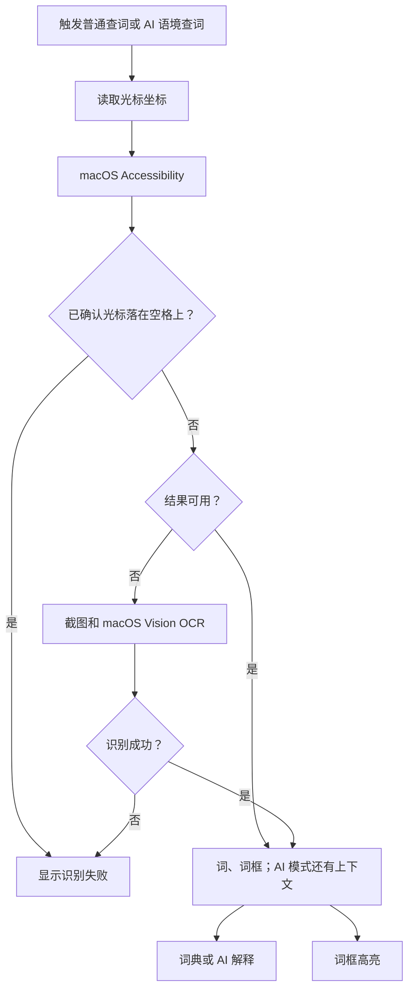

# macOS 光标取词流程

本文描述当前 macOS 普通查词和 AI 语境查词的实现。这里讨论的是光标下的文字。



## 1. 触发取词

普通查词和 AI 语境查词共用 [selection-toolbar.ts](../src/main/controller/selection-toolbar.ts) 的 `handleOcrShortcut()`：

1. 创建请求版本号并记录弹窗锚点，隐藏旧高亮。
2. AI 模式预热 explanation window。
3. 调用 `captureTextUnderCursor()`，先尝试 Accessibility，失败后再回退 OCR。

版本号用于丢弃过期结果，不会取消已经开始的原生 Accessibility 或 OCR 工作。

## 2. Accessibility 入口

[macos.ts](../src/main/accessibility/platforms/macos.ts) 获取当前光标坐标，调用原生模块 `readAccessibleText(x, y, includeContext)`：

- 普通查词传入 `includeContext = false`。
- AI 语境查词传入 `includeContext = true`。

Node 原生模块通常在工作线程执行 Accessibility 查询；如果坐标位于 Dictol 自己的窗口内，原生调用会切换到 AppKit 主线程。原生层通过 `AXUIElementCopyElementAtPosition` 获取命中元素，该元素可能是 `AXStaticText`，也可能是 `AXGroup`、`AXWebArea` 等容器。

原生层先检查辅助功能授权。未授权返回 `accessibility-not-authorized`，坐标命中调用报错返回 `hit-test:<AXError>`，两者都直接交给主进程回退 OCR。

前两次坐标命中时，如果角色是 `AXWebArea` 或 `AXScrollArea`，或者节点矩形不可用、不包含光标，就等待 20 ms 并以**同一坐标**重试。最多命中测试 3 次，重试 2 次；第三次按实际命中节点继续，不再因这些条件等待。如果第三次首次命中节点仍是 `AXWebArea` 或 `AXScrollArea`，原生层会向该节点所属应用请求启用无障碍支持，然后按原有边界规则回退 OCR。这个请求用于后续查词；Chrome 重启后不再依赖 selection hook 先读取选区。

命中的图像矩形包含光标时，直接返回 `AXImage: image-content`；第三次仍命中图像时同样返回该结果。节点矩形检查使用原始矩形，词框容差仅用于后续词定位。`invalid-character-range` 和词框未命中本身都不会触发等待。`AXVideo` 子角色按其角色走常规流程。

角色判断、重试和搜索边界检查先于 `AXValue` / `AXTitle` 读取。需要重试时，单次查找只返回内部重试状态；完成后才统一序列化 JSON，原生输出缓冲区只分配一次。

## 3. 查找词和词框

原生实现在 [accessibility.m](../native/accessibility/macos/src/accessibility.m)。词定位先检查命中节点及其子树，未命中时最多向上检查两层祖先及其尚未搜索的子树。遇到 `AXWebArea`、`AXScrollArea`、`AXWindow` 或 `AXApplication` 时停止当前尝试并返回 `<角色>: search-boundary`；子树遍历会跳过嵌套的 `AXWebArea`。

### 直接定位字符

命中节点和通过矩形筛选的子节点使用同一个单节点定位函数。对于 `value` 非空的节点，先尝试：

1. 使用 `AXRangeForPosition` 取得光标位置对应的字符范围。
2. 在已读取的节点 `AXValue` 中，用字符偏移和 `NLTokenizer` 找词；对于常见 ASCII 复合词字符，再扩展并修整词范围。
3. 使用 `AXBoundsForRange` 获取词框，验证光标是否命中。

若 `AXRangeForPosition` 返回的是空格，且该字符的 `AXBoundsForRange` 矩形包含光标，原生层返回 `no-word-at-point`。这表示光标处确定没有词：停止逐词扫描、子树和祖先搜索，主进程也不启动 OCR。无法验证空格字符框时仍按一般失败继续查找。

词框判断向四周扩展 6 个 AX 坐标单位。对于跨行的词，会尝试检查字符矩形，避免把跨行包围框中的空白当作命中。

直接定位使用完整的 `AXValue` 分词；没有文本时返回 `text-unavailable`，字符偏移超出文本时返回 `invalid-character-range`。普通查词只返回词和词框。AI 模式在词和词框命中后，才从同一 `AXValue` 截取最多 8192 个 UTF-16 代码单元的上下文。

### 向内搜索子节点

直接定位失败后，先在当前文本角色节点尝试逐词回退，再按层遍历 `AXChildren`。子树中发现的候选节点同样先调用 `AXRangeForPosition`，失败后才尝试适用的逐词回退。因此，超过 8192 个 UTF-16 代码单元的子节点仍可以通过直接定位命中。若 `AXRangeForPosition` 返回 `kAXErrorCannotComplete`，则跳过该节点的逐词回退和子树；子树搜索继续检查其他分支。

同一次命中测试中的各层子树搜索共用去重集合。对子节点的筛选规则如下。

- 节点的 `value` 为空或不可用时，若矩形不可用、高度为 1 或包含光标，则继续检查其子节点；否则跳过该子树。
- 节点有文本时，读取 `AXPosition` 和 `AXSize`；矩形不可用或不包含光标时，跳过该子树。
- 通过矩形筛选的有文本节点立即尝试直接字符定位；`AXStaticText` 和 `AXTextArea` 还可以逐词回退，成功则立即返回。
- 未命中且未发生上述通信失败的候选节点进入队列，继续逐层搜索。已尝试过的根节点不在子树入口再次定位。

命中输入框（`AXTextArea`）时，在控件自身和子节点内定位词。如果仍未找到，结束 Accessibility 查找并回退 OCR。

逐词回退使用 `NLTokenizer` 分词，从头逐个查询 token 的 `AXBoundsForRange`。token 框向四周扩展 3 个 AX 坐标单位用于筛选，最终词框仍需通过 6 单位容差的验证。该回退仍不处理超过 8192 个 UTF-16 代码单元的单节点文本。

同一候选节点的 `AXValue` 在直接定位、逐词回退和命中后的上下文扩展之间复用。token 与扩展后的词范围相同时，复用 token 矩形；只有范围发生变化才再次查询词框。直接定位和逐词回退共用词框读取与验证代码，直接定位的错误码仍保留。

**词定位的停止条件**

- 子树遍历读到一个节点有超过 100 个直接子节点时，跳过该节点的子树并继续搜索其他分支，不会因此结束整次词定位。恰好 100 个仍可搜索。
- 命中节点及其祖先的子树搜索共用 500 个不同子节点的遍历额度，包括空节点和筛选时被剪掉的节点。首次命中、重试和向上查找祖先本身不占额度。遇到第 501 个不同子节点时，记录 `node-limit:500` 并回退 OCR。命中后的 AI 内联扩展使用独立限制，不占用此额度。
- 单个节点可连续查询多个 token 或字符的矩形。代码在系统 AX 元素和命中元素上设置 0.3 秒消息超时，整次查询没有总 deadline。

## 4. 原生返回值和上下文

普通查词返回词和词框：

```ts
{ word, x, y, width, height }
```

AI 模式额外返回 `text` 和 `offset`，其中 `offset` 是 `text` 内的 UTF-16 偏移。逐词回退返回的 offset 是命中 token 的起点，不一定是光标下的精确字符位置。

搜索阶段只生成内部命中记录，持有命中节点、节点角色、已读取文本、词范围、偏移和词框。所有命中路径都交给 `finish_text_match()` 统一组装返回值；仅在 AI 模式下执行上下文归一化和内联扩展。

AI 模式命中 `AXStaticText` 时，原生层会尝试合并相邻内联文本，以处理链接、样式等造成的节点拆分：

- 仅在返回的文本与命中节点的完整 `AXValue` 归一化后一致时尝试合并。已截断的上下文窗口直接使用原结果。
- 从父节点开始，最多尝试 3 层。每次先尝试合并当前容器，成功即返回；失败时仅当当前容器的子角色以 `StyleGroup` 结尾才继续上溯。
- 单次合并最多访问 64 个节点，深度最多 4。可拼接的容器为 `AXLink` 和 `AXGroup`，嵌套的组还须是样式组。必须能表示所有子节点、找到目标且包含至少两个静态文本叶子。追加静态文本会检查累计长度是否超过 8192 个 UTF-16 代码单元。合并失败时保留原节点文本。
- `AXStaticText` 内部的 `\n` 替换为空格，保持 UTF-16 长度不变；独立 `AXLineBreak` 节点在合并时仍追加 `\n`。

## 5. 主进程接受 Accessibility 结果

[accessibility.ts](../src/main/ocr/accessibility.ts) 根据模式处理返回值：

- 普通查词取得词和词框后直接使用。
- AI 模式需要 `text` 和 `offset`，并调用 `sentenceContextAt()`。断句失败或得到的 `context` 与 `word` 完全相等时回退 OCR；一个完整句子即可使用，无需同时取得上下句。原生返回 `failure: null` 仅表示成功定位词，主进程仍会执行这一步。
- `failure: no-word-at-point` 是已确认的空格命中，普通查词和 AI 模式都直接结束，不进入 OCR。

[sentenceContextAt()](../src/main/ocr/ocr-text.ts) 使用 `Intl.Segmenter` 提取当前句和同一段落内最多各一句相邻句。它将 `\n`、`\r` 和 Unicode 段落分隔符作为边界，不跨段落补上下句。

## 6. OCR 回退

Accessibility 不可用时，[mac-ocr.ts](../src/main/ocr/mac-ocr.ts) 重新读取当前光标和所在显示器，并使用 macOS Vision 识别：

1. 普通查词以光标为中心请求约 `700 × 300` DIP 的截图区域。
2. AI 模式先取得显示器快照，从中裁出约 `1024 × 500` DIP 的区域，必要时复用同一帧。
3. 首次使用 Vision `accurate` 识别，语言列表包含英语、简体中文、繁体中文和日语。
4. AI 模式没有命中，或上下文不完整且触及截图边缘时，还可能扩大到约 `1280 × 650` DIP 并执行一次 `accurate` 识别。

截图和首次识别在同一原生任务中执行，Vision 直接使用 `CGImage`；AI 扩大区域时复用同一原生图像。原生截图失败时，主进程用 Electron 截图并将 PNG 交给原生 OCR；识别失败不会触发截图回退。AI 加载窗口在取词完成后显示。

`[Native OCR] capture` 和 `[Native OCR] recognition` 分别记录原生截图及识别的耗时；同帧重试和 PNG 识别分别使用 `snapshot recognition`、`PNG recognition` 日志。各次计时不包含主进程请求排队、后续断句或弹窗流程。

## 7. OCR 取词与显示

[selectOcrTextHit()](../src/main/ocr/ocr-text.ts) 优先找包含光标的文本行，否则尝试寻找附近的行；优先利用 OCR 字符框定位字符，没有可用字符框时按文本行的视觉宽度估算。之后使用 `Intl.Segmenter` 分词、组装周边文本并断句，再将词框映射回屏幕坐标。

当前 OCR 路径即使在普通查词模式下也会调用 `sentenceContextAt()`；断句失败时 `selectOcrTextHit()` 返回空。普通查词不依赖上下文的提前返回目前只适用于 Accessibility 路径。

最终，普通查词启动词典查询，AI 模式发送词、当前句和上下文进行解释；两者都会请求绘制词框高亮。高亮绘制和 explanation window 的加载异步进行，不保证实际显示先后顺序。两条识别路径都失败时显示错误。

## 日志与验证

原生失败串记录最后一次尝试沿祖先链遇到的失败与停止原因；`descendant-word-bounds-miss` 表示本层的子树查找没有返回词。

主进程在原生 Promise 返回后打印 `[Accessibility] read Text Via macOS Accessibility API`。其中 `elapsedMs` 从调用原生模块前开始计时，包含排队、原生查找和实际发生的 20 ms 等待；后续断句、OCR 与弹窗耗时另计。见 [macos.ts](../src/main/accessibility/platforms/macos.ts)。

原生模拟检查可在 macOS 上运行：

```sh
clang -fobjc-arc -fblocks tests/native/accessibility/macos/ax-fallback.m \
  -framework ApplicationServices -framework Foundation -framework NaturalLanguage \
  -o /tmp/dictol-ax-fallback-test && /tmp/dictol-ax-fallback-test
```
